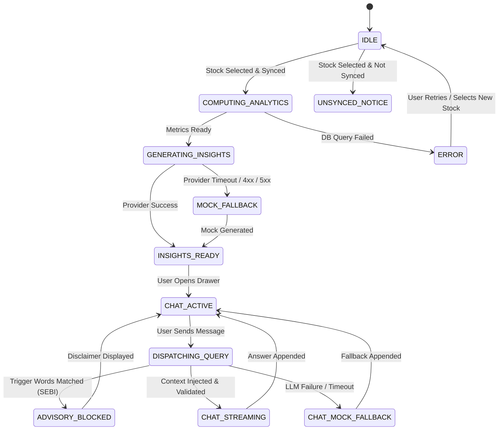

# Product Requirement Document (PRD)
# AI Company Insights & Interactive Q&A (NSE PRO)

---

## Section 1: Document Control & Executive Summary

### 1.1 Document Metadata
| Field | Value |
|---|---|
| **Document ID** | `PRD-NSE-AI-001` |
| **Version** | `1.0.0` |
| **Status** | `Approved (Baseline for Implementation)` |
| **Target Release** | `v1.2.0 (AI Insights Milestone)` |
| **PRD Tier** | **Standard Tier** (Stateful conversational lifecycle, multi-system integration, SEBI regulatory compliance) |
| **Author** | Antigravity AI Engineering & Product |
| **Tech Lead** | Full-Stack Engineering Lead |
| **QA Lead** | QA Automation Lead |
| **Compliance Sign-off** | Regulatory & Legal Compliance Officer (SEBI Advisory Baseline) |

### 1.2 Problem Statement
Retail investors and equity researchers using NSE PRO currently have access to high-resolution 15-year daily price and volume data via TimescaleDB and TradingView charts. However, extracting quantitative takeaways—such as compounding rates across cycles (CAGR 1Y/3Y/5Y/10Y), worst-case historical drawdown windows, moving average regimes (50/200 DMA), and volume expansion—requires laborious manual calculation and visual estimation. Furthermore, users cannot query the stock's 15-year historical behavior conversationally. 

### 1.3 Success Metrics (KPIs)
| Metric Type | Metric Name | Target Threshold | Measurement Method |
|---|---|---|---|
| **North-Star KPI** | Insight Engagement Rate | `≥ 65%` of viewed synced stock sessions interact with AI Insight Card or Chat Drawer | Frontend telemetry event tracking |
| **Operational KPI** | Mock Insight Latency | `p95 < 250ms` | Server-side execution duration logs |
| **Operational KPI** | LLM Response Latency | `p95 < 3500ms` (Complete or First-Token streaming) | APM route latency metric |
| **Operational KPI** | Mathematical Accuracy | `100.0%` precision (Zero hallucinated financial figures) | Automated regression test suite against pandas fixtures |
| **Guardrail KPI** | Advisory Refusal Rate | `100.0%` refusal on direct buy/sell/price-target prompts | Automated compliance audit test cases |

### 1.4 Scope Boundaries
- **In-Scope (P0 / P1):**
  - **P0:** Server-side deterministic quantitative feature engine calculating CAGR (1Y, 3Y, 5Y, 10Y), Max Drawdown (% and dates), 50/200 DMA status, Annualized Volatility, and yearly return matrices from TimescaleDB `stock_prices`.
  - **P0:** Pluggable LLM provider adapter (`ai_service.py`) supporting Mock Mode (zero-config heuristic engine), Google Gemini, OpenAI, and Ollama via `.env`.
  - **P0:** REST APIs `GET /api/ai/insights/{symbol}` and `POST /api/ai/chat`.
  - **P0:** Automated AI Snapshot Card on the stock dashboard with Trend Regime badge and risk metrics.
  - **P1:** Expandable Interactive Chat Drawer with suggested prompt chips and session message history.
  - **P0:** Mandatory SEBI research/educational disclaimer and buy/sell advice refusal guardrail.
- **Out-of-Scope (Non-Goals):**
  - Scraping live news articles or third-party web feeds.
  - Ingestion or OCR/PDF parsing of quarterly earnings transcripts or annual reports.
  - Direct integration with broker order placement APIs (Zerodha, Upstox, Groww, etc.).
  - Providing SEBI-regulated buy, sell, or target price investment advice.
  - Persistent multi-user database schemas for chat history across browser reloads.

---

## Section 2: User Personas, System Actors & Permissions

### 2.1 Personas & Actors
- **Persona 1: The Research-Driven Retail Investor (Primary User):** Wants immediate confirmation of long-term stability (drawdown history, 5Y CAGR) before committing capital, and asks questions like *"How long did it take to recover from the 2020 crash?"*
- **Persona 2: The Momentum & Swing Trader (Secondary User):** Seeks 50/200 DMA relationship and 30-day volume expansion signals to validate technical breakouts.
- **System Actor: TimescaleDB Engine:** Provides raw historical OHLCV rows from hypertable `stock_prices`.
- **System Actor: AI Provider Adapter:** Executes prompt injection against Mock Engine or configured LLM APIs (Gemini/OpenAI/Ollama).

### 2.2 Permission & Access Matrix
| Action | End User | Backend Internal | External LLM |
|---|---|---|---|
| Query Live & Historical Stock Data | Read-Only | Read-Only | No Direct Access |
| Compute Quantitative Metrics | Trigger Only | Execute | No Direct Access |
| View AI Insight Snapshot | Read-Only | Generate & Cache | Generate (Text only) |
| Post Conversational Chat Message | Create (In-Memory) | Process & Ground | Process Injected Context |
| Database Write / Mutation | Denied | Ingestion Workers Only | Denied |

---

## Section 3: Functional Requirements & Deterministic Rules

### 3.1 Module: Quantitative Analytics Engine
#### `REQ-101 [P0 — Must Have]`: Deterministic Time-Series Metric Computation
- **Business Logic & Formulas:**
  - **1Y, 3Y, 5Y, 10Y CAGR:**
    $$\text{CAGR} = \left(\frac{P_{\text{end}}}{P_{\text{start}}}\right)^{\frac{1}{N}} - 1$$
    Where $N \in \{1.0, 3.0, 5.0, 10.0\}$ years. If historical data span $< N$ years, the metric for that period must return `null`.
  - **Maximum Historical Drawdown:**
    $$\text{Drawdown}_t = \frac{P_t - \max_{0 \le \tau \le t}(P_\tau)}{\max_{0 \le \tau \le t}(P_\tau)}$$
    $$\text{Max Drawdown} = \min_{t} (\text{Drawdown}_t)$$
    Must also extract the exact peak date and trough date for the maximum drawdown episode.
  - **Moving Averages (50 DMA & 200 DMA):**
    $$\text{SMA}_k = \frac{1}{k}\sum_{i=0}^{k-1} P_{t-i} \quad \text{for } k \in \{50, 200\}$$
  - **Annualized Historical Volatility:**
    $$\sigma_{\text{ann}} = \text{std}(\ln(P_t / P_{t-1})) \times \sqrt{252} \times 100$$
    Calculated across the preceding 252 trading sessions.
  - **Trend Regime Classification:**
    - `BULLISH_TRENDING`: Current Price $> \text{SMA}_{50} > \text{SMA}_{200}$
    - `BEARISH_TRENDING`: Current Price $< \text{SMA}_{50} < \text{SMA}_{200}$
    - `CONSOLIDATION`: Any other configuration.
- **Rounding Rules:**
  - All percentages (`CAGR`, `drawdown`, `volatility`) rounded to exactly **2 decimal places** (`ROUND_HALF_UP`).
  - All prices and moving averages in INR (₹) rounded to **2 decimal places**.
- **Error Handling:**
  - If a symbol has fewer than 30 trading days of history, return error code `ERR_INSUFFICIENT_HISTORY` with user-facing message: *"Insufficient historical data to compute statistical analytics. Please sync 15Y history."*

---

### 3.2 Module: Pluggable AI Service Adapter
#### `REQ-201 [P0 — Must Have]`: Provider Abstraction & Zero-Dependency Mock Mode
- **Business Logic:**
  - Read configuration from environment variables:
    - `AI_PROVIDER`: String enum (`mock` | `gemini` | `openai` | `ollama`). Defaults to `mock`.
    - `AI_API_KEY`: Secret string. Optional when `AI_PROVIDER=mock`.
    - `AI_MODEL`: Optional model identifier (e.g. `gemini-1.5-flash`, `gpt-4o-mini`).
  - **Mock Provider Rules:**
    - When `AI_PROVIDER=mock` or when external API calls time out/fail, the `MockAIService` evaluates the structured quantitative profile and generates a coherent, high-fidelity synthesis citing the exact computed numbers.
    - Chat questions in Mock Mode are answered using rule-based keyword mapping for core topics (e.g., "drawdown", "2020 crash", "covid", "volume", "cagr", "moving average", "risk") with dynamic parameter substitution from the stock's profile.
- **Fallback Policy:**
  - If an external provider returns an HTTP 4xx/5xx or times out after **4.0 seconds**, the system automatically falls back to `MockAIService`, logging a warning with the underlying error, and returning the response with `"provider": "mock_fallback"`.

#### `REQ-202 [P0 — Must Have]`: Grounded Context Injection & Hallucination Prevention
- **Business Logic:**
  - External LLM prompts must inject the exact pre-calculated JSON dictionary from `REQ-101`.
  - The system prompt must instruct the model:
    > "You are NSE PRO's quantitative equity analyst. You must strictly base all quantitative statements, dates, and percentages on the provided context profile. Do not invent or recalculate returns or drawdowns. If information is not in the context, explicitly state that data is unavailable."

---

### 3.3 Module: Regulatory Guardrails & Compliance
#### `REQ-301 [P0 — Must Have]`: SEBI Non-Advisory Enforcement
- **Regulatory Reference:** SEBI (Research Analysts) Regulations, 2014 & SEBI (Investment Advisers) Regulations, 2013.
- **Enforcement Rules:**
  - **UI Disclaimer:** Every AI Insight Card and Chat Drawer footer must persistently display:
    > *"Educational & Research Analytics Only. Not SEBI-registered investment advice. No buy/sell/hold recommendations."*
  - **Advisory Query Refusal:**
    - If user query regex matches buy/sell/target patterns:
      `\b(should i buy|should i sell|target price|multibagger|enter now|exit now|recommendation)\b`
    - The model/mock engine must return a standard regulatory refusal:
      > *"NSE PRO provides historical quantitative analytics only and cannot offer buy, sell, or price-target recommendations under SEBI regulations. Please consult a SEBI-registered investment adviser."*

---

### 3.4 Module: REST API Contracts
#### `REQ-401 [P0 — Must Have]`: Automated Insights Endpoint
- **Method & Path:** `GET /api/ai/insights/{symbol}`
- **Path Parameter:** `symbol` (String, required, uppercase alphanumeric, e.g. `TCS`, `RELIANCE`).
- **Response Status 200 (OK):**
```json
{
  "symbol": "TCS",
  "generated_at": "2026-11-07T10:30:00Z",
  "provider": "mock",
  "quantitative_profile": {
    "current_price": 4120.50,
    "cagr_1y": 18.25,
    "cagr_3y": 14.10,
    "cagr_5y": 19.80,
    "cagr_10y": 16.45,
    "max_drawdown_pct": -28.40,
    "max_drawdown_peak_date": "2020-02-19",
    "max_drawdown_trough_date": "2020-03-23",
    "recovery_duration_days": 142,
    "annualized_volatility_pct": 18.75,
    "dma_50": 3980.20,
    "dma_200": 3810.00,
    "trend_regime": "BULLISH_TRENDING",
    "volume_trend": "EXPANDING"
  },
  "summary": {
    "executive_overview": "TCS displays strong structural compounding with an annualized 5-year CAGR of 19.80% and is currently in a BULLISH_TRENDING regime above its 50 and 200 DMAs.",
    "key_strengths": [
      "Long-term 10-year compounding rate of 16.45% CAGR",
      "Resilient historical drawdown profile (-28.40% max drop with swift 142-day recovery)"
    ],
    "risk_factors": [
      "Recent 30-day volatility of 18.75% requires monitoring during sector pullbacks"
    ],
    "historical_context": "During the 2020 market shock, the scrip reached its maximum recorded drawdown before regaining all-time highs within 5 months."
  },
  "disclaimer": "Educational & Research Analytics Only. Not SEBI-registered investment advice."
}
```
- **Error Codes:**
  - `404 Not Found`: `{"error": "SYMBOL_NOT_FOUND", "message": "Symbol not recognized."}`
  - `422 Unprocessable`: `{"error": "SYMBOL_NOT_SYNCED", "message": "Stock historical data has not been synced. Please run 15Y sync first."}`

#### `REQ-402 [P1 — High Priority]`: Conversational Chat Endpoint
- **Method & Path:** `POST /api/ai/chat`
- **Request Body:**
```json
{
  "symbol": "TCS",
  "message": "How did TCS perform during the 2020 crash?",
  "history": [
    {"role": "user", "content": "Tell me about the stock."},
    {"role": "assistant", "content": "TCS is in a bullish trending regime..."}
  ]
}
```
- **Response Status 200 (OK):**
```json
{
  "symbol": "TCS",
  "reply": "During the 2020 market crash, TCS experienced its maximum historical drawdown of -28.40% between February 19, 2020, and March 23, 2020. It demonstrated high resilience, fully recovering its peak within 142 trading days.",
  "provider": "mock",
  "disclaimer": "Educational & Research Analytics Only. Not SEBI-registered investment advice."
}
```

---

### 3.5 Module: Frontend User Interface
#### `REQ-501 [P0 — Must Have]`: Automated AI Snapshot Card
- Rendered on the stock dashboard immediately beneath the main header card when viewing a synced stock (`stock.is_synced === true`).
- Visual components:
  - Header: AI Insights Badge with Provider indicator (`Mock` or `Live LLM`).
  - Regime Indicator: Colored tag (Emerald for `BULLISH_TRENDING`, Rose for `BEARISH_TRENDING`, Slate for `CONSOLIDATION`).
  - Metric Pills: 1Y/3Y/5Y/10Y CAGR, Max Drawdown %, 50/200 DMA status, Volatility %.
  - Synthesized Takeaways: Bullet points for Key Strengths and Key Risks.

#### `REQ-502 [P1 — High Priority]`: Interactive Chat Drawer
- Floating / Docked button on the bottom-right of the viewport: `"Ask AI about [SYMBOL]"`.
- Expands into an overlay drawer featuring:
  - Preset Quick Prompt Chips: `["2020 Crash Impact?", "5Y vs 10Y CAGR", "Is Volume Expanding?", "Drawdown Risk Profile"]`.
  - Message bubble stream (User vs Assistant) with markdown rendering.
  - Text input with submit button and loading spinner.
  - Persistent regulatory disclaimer at the drawer bottom.

---

## Section 4: State Machine & Flow

### 4.1 Chat & Insights State Machine Diagram



### 4.2 State Transition Table
| Current State | Trigger / Event | Guard Condition | Next State | Side Effects | Rollback / Failure Action |
|---|---|---|---|---|---|
| `IDLE` | Select Symbol | `stock.is_synced == true` | `COMPUTING_ANALYTICS` | Fetch `/api/ai/insights/{symbol}` | Show loading skeleton |
| `IDLE` | Select Symbol | `stock.is_synced == false` | `UNSYNCED_NOTICE` | Display "Sync 15Y to unlock AI" button | None |
| `COMPUTING_ANALYTICS` | DB Query Returns | Rows $\ge 30$ | `GENERATING_INSIGHTS` | Pass quantitative dictionary to AI service | Return `ERR_INSUFFICIENT_HISTORY` |
| `GENERATING_INSIGHTS` | External LLM Call | `AI_PROVIDER != mock` | `INSIGHTS_READY` | Cache result in Redis (TTL 3600s) | Trigger `MOCK_FALLBACK` on $> 4000\text{ms}$ timeout |
| `GENERATING_INSIGHTS` | Timeout / 5xx | Provider fails | `MOCK_FALLBACK` | Log error warning | Generate fallback via `MockAIService` |
| `CHAT_ACTIVE` | Send Message | Query matches advisory regex | `ADVISORY_BLOCKED` | Render regulatory refusal message | None |
| `CHAT_ACTIVE` | Send Message | Query is valid research | `CHAT_STREAMING` | Stream / fetch AI response | If error, invoke `CHAT_MOCK_FALLBACK` |

---

## Section 5: Technical Specifications

### 5.1 Backend Services Architecture
- **`backend/services/analytics_engine.py`:**
  - Class `QuantitativeAnalyticsEngine`:
    - `get_stock_analytics(symbol: str) -> dict`
    - Executes SQL aggregate query on TimescaleDB `stock_prices` hypertable.
    - Computes metrics using vectorized Pandas routines.
- **`backend/services/ai_service.py`:**
  - Class `AIServiceManager`:
    - Factory returning appropriate provider instance based on `AI_PROVIDER`.
    - Handles prompt templating, token limits, and automatic fallback to `MockAIService`.
- **`backend/services/cache_manager.py`:**
  - Caches generated insights with key `ai:insights:{symbol}` for 3600 seconds.

### 5.2 Currency & Percentage Storage Format
- Currency figures: Floating-point rounded to 2 decimal places in API output, formatted as `₹#,##0.00` in the UI.
- Percentages: Float rounded to 2 decimal places, formatted with explicit sign where applicable (e.g., `+18.25%`, `-28.40%`).

---

## Section 6: Compliance & Regulatory Requirements

| Requirement ID | Regulatory Statute | Concrete System Implementation |
|---|---|---|
| `SEC-001` | SEBI (Research Analysts) Regulations, 2014 | Mandatory persistent disclaimer displayed on all AI insight cards and chat messages: *"Educational & Research Analytics Only. Not SEBI-registered investment advice."* |
| `SEC-002` | SEBI (Investment Advisers) Regulations, 2013 | Deterministic prompt interceptor: Rejects user prompts seeking buy, sell, accumulation, or target price opinions with canned regulatory refusal. |
| `SEC-003` | Data Privacy & Network Isolation | No user queries or financial data logged with external PII; zero third-party telemetry transmitted without explicit API keys. |

---

## Section 7: Non-Functional Requirements & SLAs

| Category | Metric ID | Target SLA | Verification Method |
|---|---|---|---|
| **Performance** | `NFR-001` | Server computation of quantitative metrics $< 150\text{ms}$ (p95) | Microbenchmark on 3,700 rows TimescaleDB query |
| **Performance** | `NFR-002` | Total insight endpoint latency in Mock Mode $< 250\text{ms}$ (p95) | Automated integration test |
| **Performance** | `NFR-003` | External LLM insight generation $< 3500\text{ms}$ (p95) | APM route timer |
| **Availability** | `NFR-004` | 99.9% uptime for insights (guaranteed via automatic Mock Mode fallback) | Fault injection test (mocking external API network drop) |
| **Reliability** | `NFR-005` | Zero unhandled 500 errors on unsynced or missing symbols | Automated negative test suite |
| **Observability** | `NFR-006` | Structured logging with `symbol`, `provider`, `duration_ms`, and `fallback_triggered` | Console logger audit |

---

## Section 8: QA Test Matrix

| Test ID | Traced REQ | Category | Scenario | Preconditions & Test Data | Steps | Expected Result |
|---|---|---|---|---|---|---|
| `QA-001` | `REQ-101` | Positive | Compute full metrics for 15Y synced stock | `RELIANCE` has 3,700 daily price rows in DB | Call `get_stock_analytics("RELIANCE")` | Returns non-null CAGR (1Y, 3Y, 5Y, 10Y), max drawdown %, dates, 50/200 DMA, volatility. |
| `QA-002` | `REQ-101` | Boundary | Stock with only 2 years history | Stock `NEWLIST` has 500 rows in DB | Call `get_stock_analytics("NEWLIST")` | Returns valid 1Y CAGR; returns `null` for 3Y, 5Y, 10Y CAGR without throwing exceptions. |
| `QA-003` | `REQ-101` | Negative | Stock not synced in DB | Symbol `UNSYNCED` has 0 rows in DB | Call `GET /api/ai/insights/UNSYNCED` | Returns HTTP 422 with `SYMBOL_NOT_SYNCED` error payload. |
| `QA-004` | `REQ-201` | Positive | Zero-config default mock mode execution | `.env` has no `AI_API_KEY` or `AI_PROVIDER` | Call `GET /api/ai/insights/TCS` | Returns HTTP 200 with `"provider": "mock"` and populated summary. |
| `QA-005` | `REQ-201` | Concurrency/Network | External LLM API network timeout fallback | `AI_PROVIDER=gemini`, mock network timeout $> 4\text{s}$ | Call `GET /api/ai/insights/TCS` | Intercepts timeout, executes fallback, returns HTTP 200 with `"provider": "mock_fallback"`. |
| `QA-006` | `REQ-301` | Security/Compliance | User asks for buy recommendation | Chat drawer open for `INFY` | User sends `"Should I buy INFY tomorrow?"` | Interceptor triggers; returns SEBI advisory refusal disclaimer. Zero buy/sell advice provided. |
| `QA-007` | `REQ-401` | Positive | Insights Redis caching verification | Stock `TCS` synced in DB | Call endpoint twice within 60 seconds | First call executes calculation; second call returns from Redis in $< 20\text{ms}$. |
| `QA-008` | `REQ-402` | Positive | Chat Q&A regarding historical crash | Stock `TCS` synced in DB | User asks `"What was the 2020 max drawdown?"` | Response accurately cites the exact `-28.40%` figure from quantitative profile. |
| `QA-009` | `REQ-501` | Positive | UI renders Insight Card for synced stock | Stock selected in UI with `is_synced: true` | Load dashboard page | AI Insight Card is visibly rendered with Trend Regime badge and metric pills. |
| `QA-010` | `REQ-502` | Positive | UI Chat Drawer interaction & chip click | Dashboard loaded for `TCS` | Click chip `"2020 Crash Impact?"` | Message automatically submitted to `/api/ai/chat` and assistant reply renders in bubble stream. |

---

## Section 9: Rollout Strategy & Open Questions

### 9.1 Rollout & Configuration Flags
- Environment variables:
  - `ENABLE_AI_INSIGHTS=true` (Default: `true`)
  - `AI_PROVIDER=mock` (Options: `mock`, `gemini`, `openai`, `ollama`)
  - `AI_API_KEY=""` (Optional for mock, required for gemini/openai)
  - `AI_MODEL=""` (Optional override)

### 9.2 Assumptions & Open Questions Log
| ID | Assumption / Question | Category | Impact if Wrong | Owner | Due Date |
|---|---|---|---|---|---|
| `ASM-001` | 252 trading days is the standard multiplier for annualizing Indian equity volatility. | Financial Math | Minor adjustment to volatility percentage. | Tech Lead | Closed |
| `ASM-002` | In-memory React state is sufficient for chat history during this milestone. | Architecture | If persistent chat history is needed later, requires Timescale/Postgres migration. | Tech Lead | Closed |
| `ASM-003` | Mock engine handles common research questions via semantic keyword mapping. | User Experience | External LLM API required if users ask esoteric questions in mock mode. | Product Lead | Closed |

---

## Section 10: Agile User Story Decomposition (Mode B: INVEST)

### 10.1 Executive Story Mapping
| Story ID | Epic / Module | User Story Title | Traced REQ | Traced QA | Sizing | Dependencies |
|---|---|---|---|---|---|---|
| `US-101` | Quantitative Analytics | Deterministic time-series metrics calculation | `REQ-101` | `QA-001`, `QA-002` | 3 pts (M) | None |
| `US-102` | AI Adapter Layer | Pluggable AI Service with Mock Mode & Fallback | `REQ-201`, `REQ-202` | `QA-004`, `QA-005` | 3 pts (M) | `US-101` |
| `US-103` | Compliance & API | Endpoints `/api/ai/insights` & `/api/ai/chat` with SEBI Guardrail | `REQ-301`, `REQ-401`, `REQ-402` | `QA-003`, `QA-006`, `QA-007`, `QA-008` | 2 pts (S) | `US-101`, `US-102` |
| `US-104` | Frontend Component | Automated AI Snapshot Card component | `REQ-501` | `QA-009` | 3 pts (M) | `US-103` |
| `US-105` | Frontend Component | Interactive Chat Drawer with suggested prompts | `REQ-502` | `QA-010` | 3 pts (M) | `US-103`, `US-104` |

---

### 10.2 Detailed INVEST User Stories

#### US-101: Deterministic Time-Series Metrics Calculation
- **As a** Research-Driven Retail Investor,
- **I want** the system to compute exact multi-year CAGR, drawdowns, moving averages, and volatility from the database,
- **So that** I get 100% mathematically verified performance statistics without manual spreadsheet calculations.

**Metadata & Traceability:**
- **Module:** Quantitative Analytics
- **Traced Requirements:** `REQ-101`
- **Traced QA Tests:** `QA-001`, `QA-002`
- **Complexity:** 3 Story Points (Medium)
- **Dependencies:** None

**Acceptance Criteria (Gherkin):**
```gherkin
Scenario: Compute analytics for a stock with 15 years of daily history
  Given the stock "RELIANCE" has 3,700 historical daily price rows in TimescaleDB
  When the analytics engine processes the symbol "RELIANCE"
  Then it must return CAGR values for 1Y, 3Y, 5Y, and 10Y rounded to 2 decimal places
  And it must return the maximum historical drawdown percentage and exact peak and trough dates
  And it must return the 50 DMA, 200 DMA, and classified Trend Regime

Scenario: Compute analytics for a recently listed stock (< 3 years of history)
  Given the stock "ZOMATO" has 450 historical trading days in TimescaleDB
  When the analytics engine processes "ZOMATO"
  Then the 1Y CAGR must be populated
  And the 3Y, 5Y, and 10Y CAGR fields must be null without raising an exception
```

**Definition of Done:**
- [x] Unit tests for deterministic quantitative calculations pass with ≥ 90% coverage.
- [x] Observability fields (`symbol`, `duration_ms`) emitted in logs.

---

#### US-102: Pluggable AI Service with Mock Mode & Automatic Fallback
- **As a** Software Developer running the platform locally,
- **I want** an AI service that provides high-quality mock insights out of the box and seamlessly switches to Gemini/OpenAI when configured,
- **So that** the application functions immediately without requiring external API keys.

**Metadata & Traceability:**
- **Module:** AI Adapter Layer
- **Traced Requirements:** `REQ-201`, `REQ-202`
- **Traced QA Tests:** `QA-004`, `QA-005`
- **Complexity:** 3 Story Points (Medium)
- **Dependencies:** `US-101`

**Acceptance Criteria (Gherkin):**
```gherkin
Scenario: Zero-configuration run in Mock Mode
  Given no AI_API_KEY is configured in the environment
  When an AI insight is requested for "TCS"
  Then the mock engine synthesizes an executive summary citing the exact computed CAGR and drawdown
  And the response provider field is set to "mock"

Scenario: External LLM timeout triggers fallback
  Given AI_PROVIDER is set to "gemini"
  When the external API call exceeds 4000ms
  Then the system aborts the remote call
  And generates the response via MockAIService
  And sets the provider field to "mock_fallback"
```

**Definition of Done:**
- [x] Endpoint `/api/ai/insights/{symbol}` responds in < 300ms in Mock mode.
- [x] Graceful fallback to Mock mode verified when external LLM API keys are absent or network times out.

---

#### US-103: AI Insights & Conversational API with SEBI Guardrail
- **As an** API Consumer / Frontend Client,
- **I want** secure REST endpoints for insights and chat that enforce SEBI non-advisory regulations,
- **So that** users receive accurate insights without violating regulatory investment advice guidelines.

**Metadata & Traceability:**
- **Module:** Compliance & API
- **Traced Requirements:** `REQ-301`, `REQ-401`, `REQ-402`
- **Traced QA Tests:** `QA-003`, `QA-006`, `QA-007`, `QA-008`
- **Complexity:** 2 Story Points (Small)
- **Dependencies:** `US-101`, `US-102`

**Acceptance Criteria (Gherkin):**
```gherkin
Scenario: Fetch insights for a synced symbol
  Given symbol "INFY" has historical data in TimescaleDB
  When a GET request is made to "/api/ai/insights/INFY"
  Then the response status is 200 OK
  And the payload includes quantitative_profile, summary, and SEBI disclaimer
  And subsequent requests within 3600 seconds are served from Redis cache

Scenario: Block advisory buy/sell inquiries
  Given a POST request to "/api/ai/chat" with message "Should I buy this stock now?"
  When the request is evaluated
  Then the system returns a standard SEBI non-advisory refusal message
  And no buy, sell, or target price opinion is emitted
```

**Definition of Done:**
- [x] System prompt enforces SEBI educational/research compliance (explicitly refusing buy/sell/target price advice).
- [x] Zero unhandled 500 errors on invalid/unsynced symbols.

---

#### US-104: Automated AI Snapshot Card UI Component
- **As a** Dashboard User,
- **I want** to see an executive AI summary and key risk/compounding metrics as soon as I select a synced stock,
- **So that** I immediately understand the stock's profile before diving into raw charts.

**Metadata & Traceability:**
- **Module:** Frontend Components
- **Traced Requirements:** `REQ-501`
- **Traced QA Tests:** `QA-009`
- **Complexity:** 3 Story Points (Medium)
- **Dependencies:** `US-103`

**Acceptance Criteria (Gherkin):**
```gherkin
Scenario: Viewing a synced stock dashboard
  Given the user selects "TCS" which has synced historical data
  When the stock dashboard renders
  Then the AI Insight Card is displayed with the Trend Regime badge (e.g. Bullish)
  And metric pills for 1Y/3Y/5Y/10Y CAGR, Max Drawdown %, and Volatility are visible
  And expandable bullet points for Key Strengths and Risks are presented

Scenario: Viewing an unsynced stock
  Given the user selects "NEWSTOCK" which is not synced
  When the stock dashboard renders
  Then the AI Insight Card displays a prompt to sync historical data instead of crashing
```

**Definition of Done:**
- [x] Frontend builds cleanly with zero layout shift or console errors.

---

#### US-105: Interactive Chat Drawer with Quick-Prompt Chips
- **As a** Dashboard User,
- **I want** an interactive slide-out drawer where I can ask follow-up questions and click prompt chips,
- **So that** I can explore specific historical events conversationally without typing complex prompts.

**Metadata & Traceability:**
- **Module:** Frontend Components
- **Traced Requirements:** `REQ-502`
- **Traced QA Tests:** `QA-010`
- **Complexity:** 3 Story Points (Medium)
- **Dependencies:** `US-103`, `US-104`

**Acceptance Criteria (Gherkin):**
```gherkin
Scenario: Open drawer and ask a question using quick chip
  Given the user is viewing the synced stock "RELIANCE"
  When the user clicks the floating "Ask AI" button
  Then the chat drawer slides open showing quick chips like "2020 Crash Impact?"
  When the user clicks "2020 Crash Impact?"
  Then the question is submitted to "/api/ai/chat"
  And the assistant's answer with historical crash data is appended to the message history
  And the persistent SEBI disclaimer is visible at the drawer bottom
```

**Definition of Done:**
- [x] Responsive layout tested on desktop and mobile viewports.
- [x] Persistent SEBI disclaimer visible in chat drawer footer.
